# 01 — Zed Fork Map (Edit Prediction)

Goal: know exactly which crates own which part of “Tab,” so you never wander the 100+ crate monorepo blind.

## Big picture

Zed already has the product you want to beat: **Edit Prediction** (internally Zeta). Your job is rarely “invent ghost text.” It is:

1. Better **context**
2. Better **model / prompt format**
3. Better **latency**
4. Better **show-vs-silence policy**
5. Better **jumps** (next cursor / next file)

```mermaid
flowchart LR
  Editor[Editor keystroke / cursor] --> Store[EditPredictionStore]
  Store --> Ctx[Context packer]
  Ctx --> Prompt[zeta_prompt formatters]
  Prompt --> Prov[Provider: Zeta / Copilot / Ollama / OpenAI-compat / Mercury]
  Prov --> Parse[Parse rewrite / FIM / NO_EDITS]
  Parse --> Diff[Diff vs buffer]
  Diff --> UI[Ghost prediction UI]
  UI --> Accept[Tab / partial accept / jump]
  Accept --> Tele[Telemetry + data_collection]
```

## Core crates (bookmark these)

| Crate | Role |
|-------|------|
| `crates/edit_prediction` | Orchestration, providers, lifecycle |
| `crates/zeta_prompt` | Prompt structs + format versions (Zeta1/2/2.1/…) |
| `crates/edit_prediction_context` | Context gathering helpers |
| `crates/edit_prediction_types` | Shared types |
| `crates/edit_prediction_metrics` | Offline/online scoring (diff-aware) |
| `crates/edit_prediction_ui` | Status bar button / provider UI |
| `crates/edit_prediction_cli` | CLI + **teacher.md** distillation prompts |
| `crates/copilot` / `copilot_ui` | Copilot provider path |
| `crates/buffer_diff` | Diff primitives for predictions |
| `crates/language` / `crates/lsp` / `crates/project` | Buffers, LSP defs/diagnostics, worktrees |
| `crates/cloud_llm_client` | Cloud predict-edits API (`predict-edits` feature) |
| `crates/telemetry` / `telemetry_events` | Accept/reject events |

### Files inside `edit_prediction/src/` (read in this order)

1. **`edit_prediction.rs`** — `EditPredictionStore`: register buffers, trigger predictions, provider routing, state machine. Huge; skim structure first, then search for request/cancel paths.
2. **`prediction.rs`** — one prediction instance: target buffer, diff hunks, apply.
3. **`zeta.rs`** — Zeta-specific path: build excerpt, call cloud/local, parse rewrite markers.
4. **`cursor_excerpt.rs`** — how the editable window around the cursor is chosen (syntax + line expansion). This is a **leverage point** for quality.
5. **`udiff.rs`** — unified-diff style encoding of recent edits (trajectory signal).
6. **`fim.rs`** — fill-in-the-middle formats for non-Zeta local models.
7. **`sweep_prompt.rs`** — Sweep-style rewrite-window format (`original/current/updated`).
8. **`ollama.rs`**, **`open_ai_compatible.rs`**, **`mercury.rs`** — alternate providers.
9. **`data_collection.rs`** — opt-in training traces (license-gated).
10. **`license_detection.rs`** — only collect from allowed OSS repos.
11. **`zed_edit_prediction_delegate.rs`** — bridge into editor actions.
12. **`edit_prediction_tests.rs`** — behavioral contract; read tests before changing behavior.

## Request lifecycle (what happens on a keystroke)

Internalize this sequence; every improvement maps to one step.

1. **Trigger** — buffer edit or cursor move; store debounces / cancels older requests.
2. **Eligibility** — settings (`show_edit_predictions`, `disabled_globs`, provider `none`), mode (`eager` vs `subtle`), conflict with LSP completion menu.
3. **Excerpt** — `cursor_excerpt` selects text around cursor; marks editable region + cursor offset.
4. **History** — recent edit events as diffs (finer granularity = better intent; Zeta2 lesson).
5. **Related context** — related file excerpts; LSP type/symbol defs; active diagnostics.
6. **Prompt pack** — `ZetaPromptInput` (or FIM / Sweep) → formatted string via `zeta_prompt`.
7. **Infer** — HTTP to Zed cloud, Copilot, Ollama, or OpenAI-compatible `/v1/completions`.
8. **Parse** — extract rewritten editable region, or `NO_EDITS`, or FIM middle; optional `<|user_cursor|>` jump marker.
9. **Diff** — predicted region vs current buffer → displayable hunks.
10. **Render** — ghost / highlight; subtle mode waits for modifier.
11. **Accept** — full Tab, next-word, next-line; apply through buffer transactions (undo-safe).
12. **Feedback** — accept / reject / ignore → metrics (+ optional training export).

## Prompt contract (Zeta rewrite style)

Zed’s teacher prompt (`edit_prediction_cli/.../teacher.md`) is the clearest spec of the task:

**Inputs**
- Chronological **edit history** (unified diffs)
- **Related excerpts** from the codebase
- **Current file** with:
  - `<|editable_region_start|>` … `<|editable_region_end|>`
  - `<|user_cursor|>`
- Optional **diagnostics**

**Outputs**
- Short intent rationale (teacher), then a code block that is **only** the editable region with edits applied
- Or `NO_EDITS`
- Optional `<|user_cursor|>` in the output = **jump prediction**

**Hard rules you must encode in data + prompts**
- Never reverse the user’s recent typed edits (the “reversal problem”)
- Accepted predictions *can* be revised later (marked `// User accepted prediction:`)
- Prefer substantive keystroke-saving edits over tiny completions when intent is clear
- Be conservative on prose/markdown

If your model violates these, users will say it “sucks” even when it is “smart.”

## Provider matrix (use before forking)

Stock Zed already supports:

| Provider setting | Use when |
|------------------|----------|
| `zed` | Default Zeta cloud |
| `copilot` | Baseline competitor |
| `ollama` | Local experiments |
| `open_ai_compatible_api` | vLLM / SGLang / llama.cpp server |
| `mercury` / `codestral` | Third-party hosted |
| `none` | Off |

`prompt_format` values include: `zeta`, `zeta2`, `zeta2_1`, FIM flavors (`qwen`, `deepseek_coder`, …), `sweep`, `infer`.

**Implication:** you can ship a SOTA *model* without a fork by speaking OpenAI completions + a Zeta prompt format. Fork when you need new context fields, jump UX, or provider semantics Zed doesn’t expose.

## Highest-leverage fork points

Ranked by ROI for beating Cursor feel:

1. **Context packer** (`cursor_excerpt`, related excerpts, LSP defs, diagnostics, edit-history granularity)
2. **Abstain policy** (`NO_EDITS` + confidence; Cursor’s RL is mostly this)
3. **Latency path** (cancelation, caching, streaming diffs, speculative decode on server)
4. **Jump prediction** (cursor marker → jump UX; cross-file portals)
5. **Telemetry schema** for your own accept/reject loop
6. **New provider** only if existing OpenAI-compat path is insufficient
7. **GPUI rendering polish** last — Zed’s UI is already strong

## Extension reality check

Zed Wasm extensions: languages, Tree-sitter, language servers, themes.

They do **not** own `EditPredictionStore`. There are ongoing discussions around generic LSP `inlineCompletion`; even that is weaker than Zeta’s rewrite+history+jump loop.

**Do not bet the project on an extension.**

## First fork exercises (concrete)

### Exercise A — Trace one prediction
1. Build Zed from source.
2. Set provider to `open_ai_compatible_api` pointing at a local logger that dumps prompts.
3. Type in a file; save every request body.
4. Annotate which parts of the prompt came from history vs excerpt vs related files.

### Exercise B — One context ablation
Add (or remove) one context channel end-to-end — e.g. strip diagnostics — and measure your personal accept rate for a day.

### Exercise C — Honor `NO_EDITS`
Force your local model to return `NO_EDITS` half the time; confirm UI stays quiet and does not flash junk. Silence UX is part of SOTA.

### Exercise D — Cursor marker
Return a rewrite that moves `<|user_cursor|>`; confirm whether your Zed version jumps. If not, that’s a fork feature to implement.

## GPL / contribution strategy

- Prototype in a private fork.
- Upstream anything that is clearly an editor improvement (context, UX, provider flexibility).
- Keep proprietary model weights/serving separate; the editor speaks HTTP.

## What “done” looks like for this chapter

You can draw the lifecycle from memory, name the crate for each step, and point to the file you’d change to:

- include import-graph neighbors in context
- change debounce
- add a new prompt format version
- log accepts for training
- wire a custom local student model
