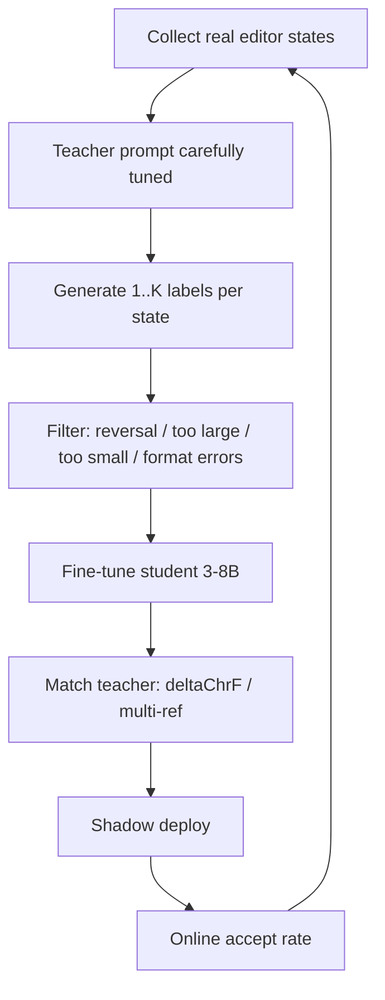

# 02 — Dataset Design for Edit Prediction

Goal: build training data that teaches **next edit**, not “pretty code” or “fix everything.”

Most Tab quality gaps are data/prompt problems disguised as model problems.

## The task definition

Each training example is:

```
state_t = {
  edit_history,          # chronological diffs leading here
  related_excerpts,      # defs / neighbors / imports
  cursor_excerpt,        # current file window
  cursor_offset,         # where the caret is
  diagnostics?,          # optional LSP errors
}
target = {
  rewritten_editable_region,  # OR NO_EDITS
  next_cursor?,               # optional jump
}
```

The model must map `state_t → target`.

Critical: the label is **not** “the eventual committed file.” It is **the immediate next edit a user would accept now.**

## Data sources ranked by realism

| Source | Realism | Volume | Notes |
|--------|---------|--------|-------|
| **In-editor traces** (opt-in) | Highest | Medium | What Zeta2 used; includes messy mid-edit states |
| **Distilled teacher labels on real states** | High (if teacher is aligned) | High | Zeta2: collect states, label with Sonnet-class teacher |
| **Git commits → synthetic edit streams** | Medium-low | Huge | Too clean; good for eval, weak for training alone |
| **FIM from raw files** | Low for Tab | Huge | Teaches insert-at-cursor, not multi-location edits |
| **Accept/reject online feedback** | Policy gold | Needs product | Cursor Tab RL; also DPO pairs |

Zed’s lesson: commit reconstruction “didn’t capture typos, second thoughts and self-corrections.” Prefer real traces.

## Example schema (store this, not vibes)

```json
{
  "id": "uuid",
  "language": "go",
  "repo": "github.com/acme/foo",
  "license_ok": true,
  "state": {
    "path": "cmd/main.go",
    "edit_history": [
      {"path": "cmd/main.go", "udiff": "--- ...\n+++ ...\n"}
    ],
    "related_excerpts": [
      {"path": "internal/server/server.go", "text": "..."}
    ],
    "cursor_excerpt": "...<|editable_region_start|>...<|user_cursor|>...<|editable_region_end|>...",
    "diagnostics": []
  },
  "label": {
    "source": "teacher|human|user_next_edit",
    "editable_region": "...",
    "no_edits": false,
    "next_cursor_included": true
  },
  "feedback": {
    "shown": true,
    "accepted": null,
    "ms_to_decision": null
  }
}
```

Keep raw markers stable so `zeta_prompt` formatters and your trainer share one contract.

## The reversal problem (must solve early)

Symptom: user types a few characters; model deletes them “because the code looked broken.”

Cause: teachers love cleaning code up. They treat the user’s last edit as a typo.

**Mitigations (stack them):**
1. Prompt rules: never restore `-` lines; never delete fresh `+` lines; if fixing requires undo → `NO_EDITS`.
2. Finer-grained recent history so “what they typed 200ms ago” is visible.
3. Filter training labels that reverse the latest user hunk (automatic checker).
4. Eval suite with adversarial partial-typing cases (Zed’s handwritten evals).

Add a unit test in your data pipeline:

```
if prediction makes editable region closer to pre-latest-edit than post-latest-edit:
    reject_label()
```

## Distillation loop (Zeta2 pattern)



Practical recipe:

1. Hand-write ~50–100 eval states covering: complete refactor, partial type, deletion mid-token, `NO_EDITS`, jump, diagnostics fix, prose conservatism.
2. Iterate **teacher prompt** until a strong model passes those evals.
3. Run teacher over ~10k–100k real states (start smaller).
4. Generate **3 teacher refs** per state (Zeta does this) — next edit is multimodal; single ref under-penalizes valid alternatives.
5. SFT student (LoRA first) on filtered labels.
6. Measure student↔teacher agreement **and** human accept rate. They diverge; both matter.

Teacher prompt reference: Zed’s `crates/edit_prediction_cli/src/prompts/teacher.md` (study it like scripture).

## What to sample (stratify or die)

Balance across:

- Languages you care about
- Edit sizes (1 token vs multi-hunk)
- Edit types: insert, delete, rename cascade, import add, test update
- Cursor positions: mid-identifier, EOL, blank line between fns
- `NO_EDITS` cases (at least 15–30% if you want low annoyance)
- Jump vs no-jump
- Files with diagnostics vs clean

If you only train on “obvious FIM,” your model becomes Copilot-with-extra-steps.

## Labels: user future vs teacher

| Label type | Pros | Cons |
|------------|------|------|
| **Actual next user edit** | True intent | Sparse; user may pause / think / leave |
| **Teacher prediction** | Dense; aligned to product rules | Teacher biases (over-help, reverse) |
| **Accepted suggestion** | Direct product signal | Only for shown suggestions; selection bias |

Best stack:

- Train content with **teacher distillation** on real states
- Train **silence / policy** with accept-reject (DPO or RL)
- Use real next-edits as a holdout eval, not the only train set

## Offline metrics that correlate with “feels good”

Prefer metrics on **changed lines**, not whole-region copy fidelity.

| Metric | Use |
|--------|-----|
| Changed-line exact match | Strict correctness |
| diff-aware chrF / deltaChrF | Softer match to teacher (Zeta-style) |
| Multi-reference match | Allow valid alternate edits |
| Reversal rate | Safety |
| Oversize rate | Reject “rewrite the world” |
| Format validity | Parseable region / markers |
| `NO_EDITS` precision/recall | Annoyance control |

Online north stars:

- Accept rate among shown
- Suggestions per KLOC / per minute (lower can be better)
- Chars accepted / keystroke
- Time-to-first-token / time-to-full-suggestion
- After-accept edit distance (accepted but immediately rewritten = soft fail)

## Minimal pipelines to build

### Pipeline 1 — Git mine (eval + warm start)

```
repos → commits → single-hunk patches →
fabricate mid-states by applying prefix of hunk →
label = remaining hunk
```

Good for bootstrap; don’t stop here.

### Pipeline 2 — Teacher distill (main train)

```
editor states or synthetic mid-states →
teacher.md → parse → filter → jsonl → SFT
```

### Pipeline 3 — Preference

```
(state, accepted_pred, rejected_pred) → DPO
or
(state, shown/accepted/rejected) → policy gradient / offline RL proxy
```

Cursor’s published reward sketch for show-policy:

- +0.75 accept
- −0.25 reject
- 0 silence  
→ suggest only if P(accept) ≳ 25%

Start simpler: binary classifier head or DPO on `(suggest, silent)` before full online RL.

## Privacy / license checklist

- Opt-in only for human traces
- Skip secret-looking buffers (`.env`, keys, `BEGIN PRIVATE`)
- Respect repo licenses if you redistribute data
- Zed separates “train on” vs “publish dataset” consent — do the same
- Redact absolute paths / emails if sharing

## Lab: build a 1,000-example v0 set this week

1. Pick one language (e.g. Go).
2. Mine 500 commit-derived mid-states.
3. Record 100 of your own editing sessions manually (painful, invaluable).
4. Run a teacher (Claude/GPT) with a Zeta-like prompt on all 600.
5. Hand-label 50 eval cases; freeze them.
6. Fine-tune a 3B–7B coder LoRA.
7. Plug into Zed via `open_ai_compatible_api` + `prompt_format: zeta2`.
8. Dogfood one day; log accepts.

If this loop isn’t fun, you will not finish a SOTA system.

## What “done” looks like for this chapter

You can explain why commit-only data fails, implement a reversal filter, run a teacher distill job, and quote the metrics you’ll use to decide ship vs iterate.
